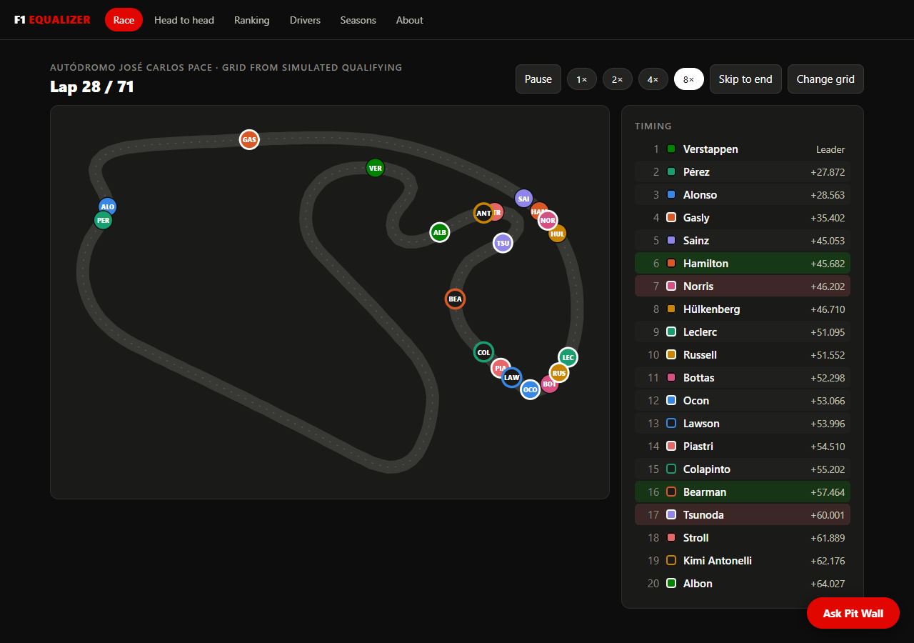
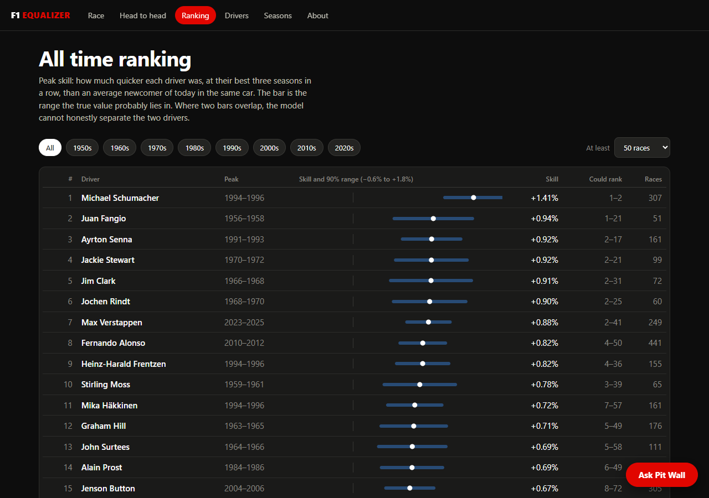
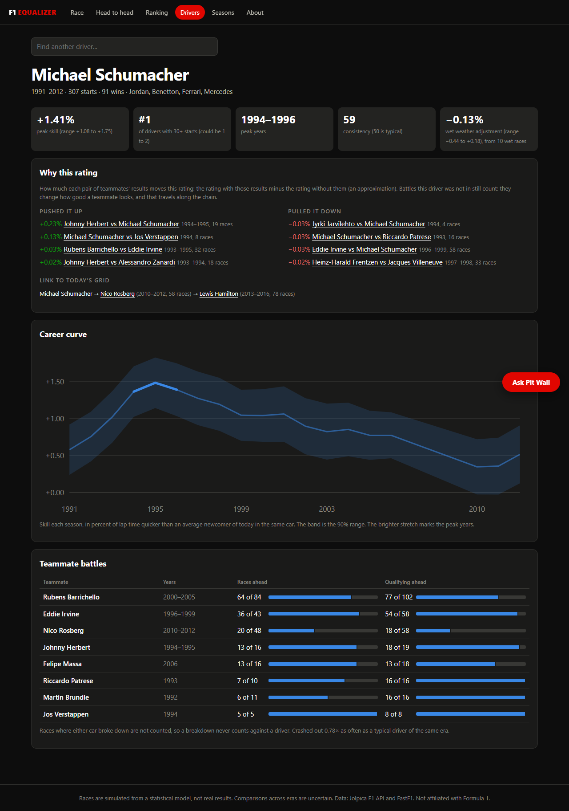
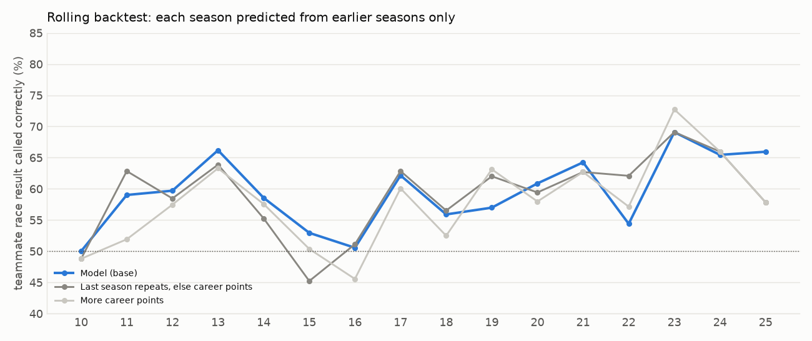
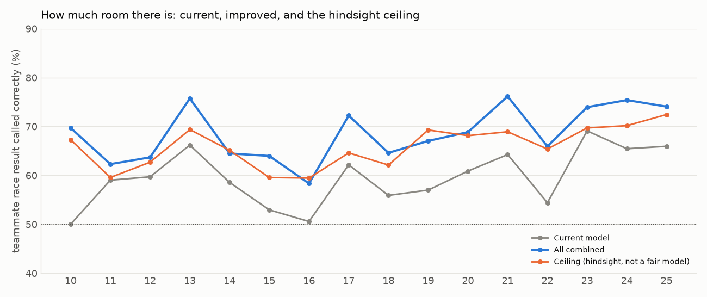

# F1-EQUALIZER

If every Formula 1 driver in history drove the same car, who would be fastest?

F1 results mix two things: how good the driver is and how good the car is.
This project separates them with a statistical model built on teammate
comparisons (teammates share the same car), linked across eras through shared
teammates. It then simulates races where every car is identical, a website
lets you race drivers from any era against each other, and an assistant
answers questions using only the model's numbers.

**Live site:** not deployed yet (the link goes here once the repository is
connected to Vercel; steps in [Deploying](#deploying)).



| | |
|---|---|
|  |  |

**In one paragraph:** a Bayesian hierarchical model, written in PyTorch and
fitted on the GPU, estimates a skill for every driver in every season since
1950, with uncertainty checked by posterior sampling. Predicting every race
from 2010 to 2025 using only earlier races, refitted before each race and
using that weekend's qualifying, it calls the right teammate in 68.6% of
2,728 race battles, close to a hindsight model that knows the season's
results (68.8%). Most of that gain is qualifying itself: "whoever qualified
ahead" alone scores 68.3%. Everything below, including where the model falls
short, is printed by a script in this repository.

## Contents

- [How the model works](#how-the-model-works)
- [Results](#results): backtest, how far prediction can go, 2024 and 2025 test, calibration, top 20, sensitivity
- [The simulation](#the-simulation)
- [The Pit Wall assistant](#the-pit-wall-assistant)
- [Weaknesses](#weaknesses)
- [Data](#data)
- [How to run it](#how-to-run-it) and [Deploying](#deploying)

## How the model works

- Every driver gets a skill number for every season they raced, measured in
  percent of lap time: +0.5 means half a percent quicker than an average
  newcomer of today in the same car (about 0.45 seconds a lap).
- The model only ever compares teammates, so the car cancels out. For each
  pair in each race it looks at who finished ahead, the qualifying lap time
  gap (from 1994) and the race pace gap (from 2018).
- Races that ended with a car failure are left out, so breakdowns never count
  against a driver.
- It is a Bayesian hierarchical model: drivers are assumed to come from one
  population, so a driver with three races is pulled towards average, and
  each season's skill is tied to the season before.
- It is fitted on the GPU in about 15 seconds. Its uncertainty was first
  worked out with a Laplace approximation and then checked with posterior
  sampling (NUTS): the sampled uncertainty is 1.03 times as wide, and the
  site uses the sampled version. Drivers with few races, few teammates or
  from older eras get wider ranges.

The code is [model.py](model.py). The reasoning is in
[docs/DECISIONS.md](docs/DECISIONS.md) (numbers 15 to 20, and 26 to 36 for
the second round of work). [docs/INTERVIEW_GUIDE.md](docs/INTERVIEW_GUIDE.md)
explains it in plain English.

## Results

### Rolling backtest, 2010 to 2025

For every season, the model was fitted on all earlier seasons only and asked
which teammate would finish ahead (`backtest.py`).



| All 16 seasons pooled | Race (2,728 comparisons) | Qualifying (3,407) |
|---|---|---|
| **Model** | **59.6%** | **61.3%** |
| Last season's head to head repeats, otherwise more career points | 59.3% | 59.7% |
| More career points | 57.9% | 57.5% |

Season by season the model beat the stronger baseline in 8 seasons, tied in
1 and lost in 7. It does best when many drivers change teams or are new,
because it can compare drivers who were never teammates: in 2025 it scored
65.9% against 57.8%. In 2022 it scored 54.4% against 62.1%.

Three optional additions were each tested this way and kept only if they did
not make the predictions worse (judged by log loss, which tests the
probabilities, not just the pick). None passed:

| Version | Race accuracy | Race log loss (lower is better) |
|---|---|---|
| **Base model (used)** | 59.6% | **0.6765** |
| Leave out race results arranged by documented team orders | 59.6% | 0.6777 |
| Assume drivers with short careers were weaker (weak-teammate correction) | 60.5% | 0.6812 |
| Separate wet weather skill in the main model | 59.2% | 0.6788 |

### How far can prediction go?

`backtest_improvements.py` predicts every race from 2010 to 2025 from earlier
races only (a check stops the script if any of the 15,788 predictions could
see its own race or a later one), tests three improvements, and compares
them with references that are allowed to see the answers.



| Pooled 2010 to 2025 | Race | Brier | Log loss | Qualifying | Brier | Log loss |
|---|---|---|---|---|---|---|
| Current model (refitted once a season) | 59.6% | 0.2394 | 0.6715 | 61.3% | 0.2342 | 0.6609 |
| + in-season updating (refit before every race) | 62.9% | 0.2267 | 0.6444 | 64.9% | 0.2181 | 0.6270 |
| + qualifying signal (same weekend, before the race) | 68.8% | 0.2116 | 0.6137 | | | |
| + experience curve (rookies improve, veterans decline) | 60.1% | 0.2383 | 0.6695 | 62.1% | 0.2333 | 0.6591 |
| **All combined** | **68.6%** | **0.2073** | **0.6035** | **66.3%** | **0.2118** | **0.6119** |
| Baseline: whoever qualified ahead finishes ahead | 68.3% | 0.2172 | 0.6261 | | | |
| Ceiling: model fitted with the season's own results | 65.9% | 0.2121 | 0.6120 | 69.8% | 0.1923 | 0.5653 |
| Ceiling + qualifying (hindsight) | 68.8% | 0.2021 | 0.5903 | 69.8% | 0.1923 | 0.5653 |

Lower Brier and log loss are better (a coin flip scores 0.25 and 0.693). Each
improvement helped on its own and all three are kept. What it shows:

- **Single races are mostly luck.** Even fitted on the season's own results,
  the model calls only 65.9% of race battles. The fair combined model gets
  within 0.2 points of the matching hindsight reference.
- **Qualifying does most of the work.** The simple rule "whoever qualified
  ahead finishes ahead" already scores 68.3%; the model adds 0.3 points of
  accuracy and better probabilities on top.
- **In-season updating** is the biggest gain that comes from the model itself:
  +3.3 points for races and +3.6 for qualifying.
- **Leakage was checked** because three seasons went above 75% (2013, 2021,
  2024): the simple qualifying rule was just as high in those seasons, and
  giving each race the previous race's qualifying instead drops the combined
  model back to 63.2%. Details: [docs/DECISIONS.md](docs/DECISIONS.md),
  numbers 38 to 40.

### The 2024 and 2025 test

Fitted on results up to the end of 2023, then predicting 2024 and 2025
without refitting (`validate_model.py`).

| | Comparisons | Model | More career points | Last season repeats, else career points |
|---|---|---|---|---|
| 2024 race | 191 | 65.4% | 66.0% | 66.0% |
| 2025 race | 185 | **68.6%** | 57.8% | 57.8% |
| Both, race | 376 | **67.0%** | 62.0% | 62.0% |
| Both, qualifying | 472 | **70.1%** | 65.0% | 65.0% |

Finishing positions predicted from 2023 information only (average miss in
places): 3.15 in 2024 against 3.48 for the car alone and 3.34 for the 2023
standings; 4.41 in 2025, worse than the 2024 standings (3.61), because the
model was still using 2023 cars.

### Calibration: are the probabilities honest?

The first version looked too cautious on 2024 and 2025 (favourites given 80%
or more won 39 of 39). To fix it properly, one "temperature" that scales every
probability was learned from the backtest's 2010 to 2023 predictions. It came
out at **0.45**: across those seasons the model was too *confident*, not too
cautious. Applied to 2024 and 2025, as the rule set in advance required, it
made things worse:

| 2024 and 2025 races | Brier score | Log loss |
|---|---|---|
| Before | **0.2045** | **0.5939** |
| After (temperature 0.45) | 0.2169 | 0.6250 |
| A coin flip | 0.2500 | 0.6931 |

The reason is drift: the best temperature was 0.25 for 2010 to 2015, 0.40 for
2016 to 2019 and about 1.0 since 2018. The site uses 0.55, fitted on all
seasons after the test (the same rule as refitting the model on all data), so
its probabilities for modern drivers are probably too cautious. Posterior
sampling suggests why the model was over-confident: the full posterior of the
race slope is 2.03 to 2.32, while the single best fit used for predictions is
2.91. Details in [docs/DECISIONS.md](docs/DECISIONS.md), numbers 27 and 32.

### The top 20

Peak skill among drivers with at least 30 starts (`fit_ratings.py`,
`compare_ratings.py`). "Could rank" is the middle 90% of plausible ranks from
1,000 posterior samples.

| # | Driver | Peak | Skill (90% range) | Could rank | Rank before the experience curve |
|---|---|---|---|---|---|
| 1 | Michael Schumacher | 1994 to 1996 | +1.57 (+1.26 to +1.88) | 1 to 1 | 1 |
| 2 | Ayrton Senna | 1989 to 1991 | +1.00 (+0.64 to +1.36) | 2 to 16 | 3 |
| 3 | Max Verstappen | 2023 to 2025 | +0.96 (+0.70 to +1.22) | 2 to 43 | 7 |
| 4 | Jackie Stewart | 1970 to 1972 | +0.94 (+0.52 to +1.35) | 2 to 26 | 4 |
| 5 | Juan Manuel Fangio | 1953 to 1955 | +0.94 (+0.47 to +1.40) | 2 to 29 | 2 |
| 6 | Jim Clark | 1963 to 1965 | +0.92 (+0.49 to +1.35) | 2 to 32 | 5 |
| 7 | Heinz-Harald Frentzen | 1994 to 1996 | +0.89 (+0.58 to +1.19) | 4 to 40 | 9 |
| 8 | Jochen Rindt | 1968 to 1970 | +0.88 (+0.46 to +1.30) | 2 to 36 | 6 |
| 9 | Mika Häkkinen | 1994 to 1996 | +0.86 (+0.54 to +1.17) | 4 to 44 | 11 |
| 10 | Fernando Alonso | 2010 to 2012 | +0.81 (+0.52 to +1.11) | 5 to 71 | 8 |
| 11 | Jacques Villeneuve | 1997 to 1999 | +0.80 (+0.50 to +1.10) | 5 to 49 | 21 |
| 12 | Jenson Button | 2004 to 2006 | +0.80 (+0.50 to +1.09) | 6 to 60 | 16 |
| 13 | Nico Rosberg | 2009 to 2011 | +0.79 (+0.41 to +1.17) | 3 to 76 | 28 |
| 14 | John Surtees | 1963 to 1965 | +0.78 (+0.32 to +1.23) | 4 to 62 | 14 |
| 15 | Alain Prost | 1984 to 1986 | +0.77 (+0.42 to +1.12) | 4 to 48 | 15 |
| 16 | Jarno Trulli | 2000 to 2002 | +0.77 (+0.50 to +1.04) | 6 to 51 | 24 |
| 17 | Gilles Villeneuve | 1980 to 1982 | +0.74 (+0.30 to +1.17) | 4 to 73 | 26 |
| 18 | Graham Hill | 1962 to 1964 | +0.73 (+0.33 to +1.14) | 5 to 63 | 13 |
| 19 | Alberto Ascari | 1952 to 1954 | +0.73 (+0.27 to +1.20) | 4 to 67 | 12 |
| 20 | Stirling Moss | 1959 to 1961 | +0.73 (+0.28 to +1.18) | 4 to 66 | 10 |

Read the "could rank" column before the first. Apart from Schumacher, the
model cannot honestly separate these drivers. Ranks are counted among drivers
with at least 30 starts: drivers with a handful of races have ratings that are
mostly guesswork, and including them had pushed Hamilton's range down to 134th.

The experience curve (kept because it improved the backtest) reshuffled this
list: each season's skill now includes the typical gain or loss for a
driver's year in F1, so peaks move for drivers whose best seasons came early
or late, and the changes travel along the teammate chains. 68 ranked drivers
moved more than 10 places (for example Nico Rosberg 28th to 13th and Stirling
Moss 10th to 20th). Lewis Hamilton is now 21st; his rating rests on close
battles with strong teammates (Rosberg, Bottas, Russell), and the "Why this
rating" panel on his driver page shows exactly which ones.

### Which rankings depend on an assumption?

How much the general level of drivers changed between decades cannot be
measured, so `sensitivity.py` refits the model under three assumptions (0.03%,
0.10% and 0.25% per decade). Only four of the top 20 keep their rank within
3 places under all three: Schumacher, Senna, Frentzen and Häkkinen (ten did
before the experience curve). The rest depend on the assumption, often a lot:
Fangio 5th to 14th, Clark 2nd to 16th, Moss 12th to 41st, Alonso 4th to 20th,
Verstappen 2nd to 7th. The full table is on the site's About page.

## The simulation

Every car is identical. Each driver's lap times come from their skill, a
form for the day, a small lap to lap noise and occasional mistakes; a car
that catches another passes with a probability that depends on its pace
advantage and the circuit (overtaking difficulty measured from real races
since 2018: Monaco hardest, Las Vegas easiest); about half of races have a
safety car (the measured rate). The randomness is calibrated so drivers beat
each other as often as the model says: for a 0.4% skill gap, model 76.2%,
simulation 75.8%. 20,000 races run in under a second on the GPU, and the
browser runs the same race from the same settings.

The first version stuck to the starting grid. Measured on 1,000 races with
today's grid at Interlagos (`check_simulator.py`):

| | Old, 15 laps | Old, 71 laps | New, 71 laps |
|---|---|---|---|
| Grid vs finish rank correlation (real F1 2018 to 2025: 0.742) | 0.931 | 0.913 | 0.657 |
| Average places moved | 1.90 | 2.17 | 3.86 |
| Top rated driver wins from pole / 5th / 15th | 55% / 15% / 4% | 41% / 22% / 16% | 48% / 19% / 15% |
| Fastest lap by a top 3 rated driver | 52.1% | 52.1% | 49.1% |
| Median gap, winner to 2nd / to 10th | 2.6s / 14.4s | 9.4s / 46.6s | 5.8s / 36.9s |

(New column with the current ratings, which include the experience curve.)
The fastest lap did not improve: on the day, the calibrated form (0.40% of a
lap) outweighs the gaps between today's top drivers.

On the all-time top 20 grid (`check_simulator.py --race-page`), Schumacher
takes pole in 46% of simulated qualifying sessions (each real season's best
qualifier from 2014 to 2025 took 20% to 62.5%), and top 10 rated drivers who
start 16th to 20th at Silverstone gain about 3 to 4 places, against 4.2 for
all real drivers starting there from 2018 to 2025.

## The Pit Wall assistant

A chat panel on every page answers questions such as "Would Senna beat
Verstappen at Monaco in equal cars?". It uses Claude (Anthropic's API) with
seven tools that read the model's numbers, and it is not allowed to invent
any: every number in an answer is checked against the tool results, an answer
with an untraceable number is sent back for one rewrite, and anything still
untraceable is flagged to the reader. Answers state the uncertainty and that
they are model estimates. With no API key the panel says it is unavailable;
rate limits stop a public link from running up a bill.

**Evaluation score: not measured yet.** The evaluation set
([web/eval/questions.json](web/eval/questions.json): 15 factual questions
with known answers, 30 comparisons, 5 trick questions that must be declined)
and its scoring script are in place, and the free checks pass
(`npm run eval -- --dry`: every expected tool call works and every known
fact matches the data). The live evaluation calls the API, so it needs a key,
which was not available on the development machine. Run it with:

```
cd web
$env:ANTHROPIC_API_KEY = "your key"   # PowerShell; the key never goes in the code
npm run eval
```

It prints four scores (right tool, expected numbers quoted, no invented
numbers, correct refusals) and writes `web/eval/results.json`. The score
should be added here once measured.

## Weaknesses

- **Cross-era comparisons cannot be validated.** There is no test for Senna
  against Verstappen; only the modern end is checked, and the sensitivity
  table shows which rankings rest on an assumption.
- **Race outcomes are mostly luck.** Even in hindsight, a season-level model
  calls about two thirds of teammate race battles. With same-weekend
  qualifying the model reaches 68.6%, but "whoever qualified ahead" alone
  gets 68.3%.
- **The experience curve improved predictions but made the cross-era ranking
  more fragile**: only 4 of the top 20 are solid under all three era
  assumptions, and 68 drivers moved more than 10 places when it was added.
- **Calibration drifts over time**: probabilities for modern drivers are
  probably too cautious.
- **Teammate strength and team orders**: a driver measured only against weak
  teammates, or against a number two, can be flattered. Two fixes were
  tested and neither helped (Heinz-Harald Frentzen at 9th is probably an
  example).
- **The rating is a driver's best three seasons**, which flatters everyone a
  little and long careers most.
- **The race slope used for predictions (2.80) is steeper than its posterior
  (1.94 to 2.24)**: the single best fit is not typical of the plausible ones.
- **Wet weather ratings rest on 54 tagged races** (37 from a hand-made list),
  so most drivers' wet adjustments barely move from zero.
- **The simulator** leaves out tyres, pit stops and weather, and the fastest
  lap goes to a top 3 driver only half the time.
- **The assistant's evaluation has not been run** (see above).

## Data

Public data only:

- [Jolpica F1 API](https://github.com/jolpica/jolpica-f1) (the successor to
  Ergast): every race and qualifying result since 1950.
- [FastF1](https://github.com/theOehrly/Fast-F1): lap times and track
  coordinates for 2018 onwards.

What the cleaned data holds (downloaded 2026-10-09, printed by
`clean_history.py` and `clean_laps.py`):

| Decade | Seasons | Races | Drivers | Starts | Car failure | Driver error | Teammate pairs | Pairs with a comparable race |
|---|---|---|---|---|---|---|---|---|
| 1950s | 10 | 84 | 307 | 1,834 | 36.6% | 8.0% | 2,809 | 1,120 |
| 1960s | 10 | 100 | 192 | 1,899 | 40.1% | 6.5% | 1,906 | 698 |
| 1970s | 10 | 144 | 153 | 3,427 | 32.7% | 12.3% | 2,222 | 937 |
| 1980s | 10 | 156 | 103 | 3,920 | 39.6% | 12.8% | 1,686 | 662 |
| 1990s | 10 | 162 | 96 | 3,860 | 30.6% | 17.3% | 1,844 | 940 |
| 2000s | 10 | 174 | 71 | 3,611 | 19.0% | 11.5% | 1,798 | 1,185 |
| 2010s | 10 | 198 | 66 | 4,265 | 10.2% | 7.3% | 2,118 | 1,674 |
| 2020s | 7 | 147 | 40 | 2,945 | 3.0% | 3.0% | 1,460 | 1,165 |
| **All** | **77** | **1,165** | **789** | **25,761** | | | **15,843** | **8,381** |

- 643 of the 655 drivers who ever had a teammate are linked to each other
  through chains of shared teammates.
- Lap times: 163,011 clean racing laps from 183 races since 2018.
- Track outlines: 33 circuits. Wet races: 54 (`wet_races.py`).
- From 2023 the source no longer says why a car retired, so those races are
  left out of teammate comparisons, and a driver's own crashes stop counting
  against them. Before 1970 a "constructor" often means a car maker that sold
  to private owners. Qualifying lap times only exist from 1994. Details in
  [docs/DECISIONS.md](docs/DECISIONS.md), number 14.

## How to run it

```
.venv\Scripts\python.exe check_gpu.py           # once: proves PyTorch trains on the GPU
.venv\Scripts\python.exe -m pytest              # the Python tests (62)

.venv\Scripts\python.exe download_history.py    # 1. results since 1950 (about 15 minutes)
.venv\Scripts\python.exe clean_history.py       # 2. results and teammate pairs
.venv\Scripts\python.exe download_laps.py       # 3. lap times since 2018 (several hours)
.venv\Scripts\python.exe clean_laps.py          # 4. pace and consistency per race
.venv\Scripts\python.exe download_circuits.py   # 5. track outlines (about 10 minutes)
.venv\Scripts\python.exe wet_races.py           # 6. tag wet races

.venv\Scripts\python.exe backtest.py            # 7. rolling backtest 2010 to 2025 (about 40 minutes)
.venv\Scripts\python.exe backtest_improvements.py  # 7b. ceiling, in-season updating, qualifying, experience (about 90 minutes)
.venv\Scripts\python.exe validate_model.py      # 8. fit to 2023, test on 2024 and 2025 (1 minute)
.venv\Scripts\python.exe sample_posterior.py    # 9. posterior samples with NUTS (about 4 minutes)
.venv\Scripts\python.exe fit_ratings.py         # 10. final ratings from all data
.venv\Scripts\python.exe explain_ratings.py     # 11. "Why this rating" panels
.venv\Scripts\python.exe sensitivity.py         # 12. top 20 under three era assumptions
.venv\Scripts\python.exe export_web.py          # 13. simulate, write the website's data
.venv\Scripts\python.exe check_simulator.py     # 14. simulator statistics

cd web
npm install
npm test                                         # the website tests (31)
npm run dev                                      # the site at http://localhost:3000
```

The order and how the files connect are in [docs/MAP.md](docs/MAP.md).

## Deploying

The site is a Next.js app in `web/`, hosted free on Vercel. Every page is
pre-built; only the assistant's `/api/chat` endpoint runs on the server. The
Anthropic API key is set in Vercel's settings, never in the code. Step by step
instructions are in [docs/DEPLOY.md](docs/DEPLOY.md).

## The earlier project

This repository used to hold an F1 race strategy simulator. It is kept in
[archive/](archive/README.md).
